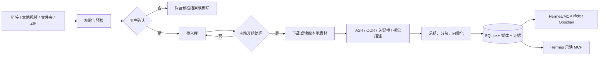

<div align="center">
  <h1>TokBrain</h1>
  <p><strong>把你有权处理的视频整理成可检索、可追溯的本地多模态知识库。</strong></p>
  <p>链接预检 · 本地视频 · 外部数据包 · ASR/OCR/关键帧 · 本地检索 · Obsidian · Hermes</p>
  <p>   <a href="LICENSE"></a></p>
</div>

> [!IMPORTANT]
> **本项目基于 [TokBrain](https://github.com/fyfsxkh/TokBrain) 二次开发**，原作者与版权所有者为 TokBrain contributors，上游采用 MIT 许可。
> 基线为上游 `v1.0.0`（commit `e022d41b`，2026-08-12，API contract 7）；上游 `LICENSE` 与 `THIRD_PARTY_NOTICES.md` 均原文保留。
> 本项目为**非官方二次开发版本**，与原作者无隶属关系；「TokBrain」名称及相关权利归原作者所有。
> 本次二次开发新增内容（多平台解析、Cookie 保险库、飞书集成、Agent 控制层与 MCP 通道、向量存储、启动器与文档体系）详见 **[FORK_NOTICE.md](./FORK_NOTICE.md)**。

TokBrain 是单机、单用户、本地优先的知识库应用。它只处理用户明确提交且有权处理的内容：先预检和确认，再创建入库任务；处理结果保留原始证据、时间戳和来源，便于检索、问答和导出。

当前应用版本为 **v1.0.0**，数据库迁移目标为 **schema v11**，API contract 为 **7**。默认服务只监听本机：前端 `127.0.0.1:3001`，后端 `127.0.0.1:8001`。

## 当前能力

| 能力 | 当前行为 |
|---|---|
| 链接导入 | 公开链接先预检、去重、展示权限与处理范围；用户确认后才进入待入库，必须再次主动开始处理 |
| 本地视频 | 单文件导入，执行魔数、容器、视频轨、大小、时长和 SHA-256 校验 |
| 外部数据包 | 选择文件夹或 ZIP，识别 JSON/CSV/F2 元数据，安全解包并匹配本地视频 |
| 多模态处理 | 字幕/ASR、关键帧、OCR、视觉描述、总结、知识分块和向量化 |
| 证据约束 | 只有已入库、已处理且有原始证据的内容进入检索；证据不足会标记为待补件或异常 |
| 知识库 | 待入库、已入库、待补件、异常、归档、收藏夹、总结和永久删除 |
| 知识检索 | 当前通过只读 Hermes/MCP 搜索作品、摘要和带时间戳的知识片段；网页端尚无问答入口 |
| 本机检索 MCP | `127.0.0.1:8010` 只读 MCP，工具名 `kb_*`；默认绑定回环地址，改绑非回环必须配置令牌 |
| 导出 | Markdown 与本地图片导出到 Obsidian |
| 飞书同步 | 飞书多维表格 → Obsidian 占位笔记 → 处理完成后回填 → 状态回写飞书；桥接进程独立常驻，侧边栏显示连接状态与扫码续期 |
| Hermes 接入 | NAS 上的只读 stdio MCP，支持搜索、作品摘要、时间轴、合集和统计 |

## 处理流程



链接预检不会自动下载完整视频、调用 AI 或创建处理任务。权限不明确时，流程会收窄为字幕、独立音频或基础信息；本地和外部数据包不会访问 F2，也不消耗链接解析额度。

## 快速开始（Windows）

环境要求：64 位 Python 3.12、Node.js 22+、npm 10+、`ffmpeg`/`ffprobe`，以及需要进行 AI 处理时的阿里云百炼 API Key。密钥由 Windows DPAPI 保护，不要把 API Key 写入仓库或提交到 `.env`。

`ffmpeg` 可以加入 PATH，也可以把便携版解压到 `tools\ffmpeg\bin`，或用环境变量 `FFMPEG_BIN` 指向它的 `bin` 目录——安装与启动脚本都会自动探测（见 `docs/TokBrain依赖与构建清单.md`）。

```powershell
git clone https://github.com/fyfsxkh/TokBrain.git
cd TokBrain
.\TokBrain.cmd
```

`TokBrain.cmd` 是唯一入口：双击后是菜单，选 `1` 安装/重建（首次使用），装完选 `2` 或 `3` 启动。也可以直接带子命令跑，便于脚本化：

```powershell
.\TokBrain.cmd status          # 只打印环境与服务状态
.\TokBrain.cmd install         # 安装/重建（等价于 setup.cmd）
.\TokBrain.cmd install -WithMcp   # 同时装 MCP 环境（只读 8010 与控制 8011 共用 .venv-mcp）
.\TokBrain.cmd start           # 前台启动，关闭窗口即停
.\TokBrain.cmd start-bg        # 隐藏窗口启动
.\TokBrain.cmd stop            # 停止
.\TokBrain.cmd restart         # 重启
.\TokBrain.cmd dev             # 开发模式（后端 + 前端热更新）
.\TokBrain.cmd dev-stop        # 停止开发模式实例（[4] 停不掉的就是它）
.\TokBrain.cmd mcp             # 启动只读 MCP 服务（:8010）
.\TokBrain.cmd control         # 启动控制 MCP 服务（:8011，可写）
.\TokBrain.cmd open            # 打开网页
```

服务就绪后打开 <http://127.0.0.1:3001>；后端健康检查为 <http://127.0.0.1:8001/health>，API 文档为 <http://127.0.0.1:8001/docs>。日志位于 `data/logs/`，运行状态位于 `data/runtime.json`。

`dev-stop` 与 `stop` 分工不同：`stop` 只停 `data/runtime.json` 记录在案的受管实例（`start` / `start-bg` 起的），`dev-stop` 只停 `dev.cmd` 拉起的前后端（按端口 + 进程名 + 命令行识别，不读也不写 `runtime.json`）。控制台状态面板会把两者分别标成「受管实例」和「非受管实例」。

原来的 `安装.cmd`、`setup.cmd`、`启动.cmd`、`start.cmd`、`停止.cmd`、`重启.cmd`、`dev.cmd` 仍然可用，行为不变，只是不再需要记哪一个。

需要飞书 ↔ Obsidian 同步时，再单独双击 `启动飞书同步.cmd`——它是常驻独立进程，不随后端一起启动。

第一次使用：在“设置”保存模型 Key；在“导入”完成预检和确认；在“知识库”查看处理结果。需要问答或检索时使用下述 Hermes/MCP 接入；网页端当前没有“对话”入口。没有足够证据的问题必须返回“未找到”或要求补充，不会把标题或旧总结当成可靠事实。

## Hermes / NAS 接入

当前接入是只读知识副本模式：Windows TokBrain 生成 SQLite 一致快照，NAS 上的 MCP 以 `mode=ro&immutable=1` 打开副本；Hermes 通过 stdio 启动 MCP，不开放 8010 等网络端口，也不直接写数据库。

调用约束：

1. 只有问题可能涉及收藏视频或已保存资料时调用 TokBrain。
2. 先调用 `tokbrain_search(query, limit=3)`；片段足够就立即回答。
3. 缺少关键结论才调用一次 `tokbrain_get_work`。
4. 用户追问原话或细节时才调用 `tokbrain_get_transcript`，默认 4 段、最多 8 段。
5. 每个问题最多三次 TokBrain 调用，不重复相同参数。
6. 回答只能依据工具证据，并附作品标题和时间戳；用户需要时再给 URL。

相关文件是 `mcp_server/tokbrain_hermes_stdio.py`、`scripts/export_tokbrain_snapshot.py`、`scripts/deploy_tokbrain_snapshot.ps1` 和 `docs/tokbrain-hermes-nas.md`。更新 NAS 副本：

```powershell
powershell -ExecutionPolicy Bypass -File scripts/deploy_tokbrain_snapshot.ps1
```

禁止让 Windows 或其他主机通过 SMB/NFS 直接打开 NAS 上的 SQLite。若要把完整 TokBrain 后端迁移到 Linux/NAS，还需要完成数据目录可配置化、Linux 密钥后端和 `sqlite-vec`/ffmpeg 兼容性验证。

## 外部 Agent 控制面（8011，可写）

上面那条是一条**只读**通道。要让外部 Agent 真正干活——导入、触发解析、重试、启停服务——需要另一条通道：本机 `mcp_server/mcp_control.py`（默认 `:8011`，33 个 `tb_*` 工具），它把既有的 8001 REST 暴露出去，自身不碰数据库。

```bat
:: 一次性准备
copy mcp_server\control.env.example mcp_server\control.env
.venv-mcp\Scripts\python.exe -c "import secrets;print(secrets.token_hex(16))"
::   → 填进 TOKBRAIN_CONTROL_TOKEN，HOST 改成局域网地址

:: 启动（或 TokBrain.cmd control / 菜单 [8]）
mcp_server\启动控制MCP.cmd

:: 命令行：零依赖，任何 Python 3.10+ 都能跑
tbctl.cmd doctor
tbctl.cmd status
tbctl.cmd import links --text "https://v.douyin.com/xxxx/"
tbctl.cmd batch get b_xxx --wait 120
```

默认是关闭的：不设 `TOKBRAIN_CONTROL_ENABLE=1` 会直接拒绝启动；非回环监听必须配 ≥32 位令牌；防火墙只放行 `192.168.10.0/24`。完整工具清单、Hermes 配置与排障见 [控制面运行手册](docs/tokbrain-control-plane.md)。

三条通道的分工：**NAS 快照**回答历史（离线可用）、**8010** 供本机工具只读查询、**8011** 处理实时操作。PC 关机时只有第一条还能用，所以不要删掉它。

## 目录结构

```text
app/                         FastAPI 后端、模型、迁移、处理流水线
frontend/                    Next.js 前端（4 个页签：导入 / 解析 / 知识库 / 设置）
tokbrain_control/            控制面内核（纯标准库）：CLI 与 MCP 共用，含 client/service/commands
mcp_server/                  三套 MCP：只读 8010（kb_*）、Hermes stdio（tokbrain_*）、控制 8011（tb_*）
tbctl.cmd                    控制面命令行入口（等价 python -m tokbrain_control）
bridge_feishu_obsidian.py    飞书 ↔ Obsidian ↔ TokBrain 同步桥（--watch 常驻）
启动飞书同步.cmd             以 --watch 启动同步桥（独立进程，不随后端启动）
cli/                         飞书扫码续期依赖的 @larksuite/cli
scripts/                     安装、启动、快照、部署、审计和验收脚本
prototypes/                  历史交互原型（单文件 HTML，不由前端托管）
tests/                       后端与前端契约测试
data/                        SQLite、媒体、关键帧、日志、运行状态和分发队列
docs/                        API、数据结构、导入、Hermes、同步与操作文档
```

## 文档索引

| 类别                     | 文档                                                                                                                                                                                                                                                                                                            | 说明                         |
| ---------------------- | ------------------------------------------------------------------------------------------------------------------------------------------------------------------------------------------------------------------------------------------------------------------------------------------------------------- | -------------------------- |
| **当前有效**               | [操作说明书](操作说明书.md)                                                                                                                                                                                                                                                                                             | 面向使用者的完整手册，含飞书同步与 MCP 两章   |
|                        | [SECURITY.md](SECURITY.md)                                                                                                                                                                                                                                                                                    | 本地安全模型、MCP 攻击面、凭据出站约束      |
|                        | [docs/表结构说明.md](docs/表结构说明.md)                                                                                                                                                                                                                                                                                | 数据库字段与向量虚表，按 schema v11 校订 |
|                        | [docs/外部批量导入 API v1](docs/external-import-v1.md)                                                                                                                                                                                                                                                              | 程序化导入接口                    |
|                        | [docs/Hermes NAS 手册](docs/tokbrain-hermes-nas.md)                                                                                                                                                                                                                                                             | 只读副本的部署、更新与回滚              |
|                        | [docs/控制面运行手册](docs/tokbrain-control-plane.md)                                                                                                                                                                                                                                                               | 8011 控制面的工具清单、Hermes 配置与排障   |
|                        | [docs/diagrams/](docs/diagrams/README.md)                                                                                                                                                                                                                                                                      | 功能链路图与信任边界图（可交互 HTML）       |
|                        | [docs/功能层级结构图](docs/TokBrain功能层级结构图.md)                                                                                                                                                                                                                                                                       | 前端/后端/服务/数据/外部集成全景         |
|                        | [docs/传参说明.md](docs/传参说明.md)                                                                                                                                                                                                                                                                                  | 三个脚本与关键接口的参数               |
|                        | [CHANGELOG](CHANGELOG.md)                                                                                                                                                                                                                                                                                     | 变更记录（含 2026-10-29~30 变更汇总） |
| **历史记录（保留结论原文，以代码为准）** | `docs/work-summary-2026-08-29.md`、`docs/测试数据回落检测-20260829.md`、`docs/状态同步五问题-方案汇总-20260829.md`、`docs/慢轨标签打通方案.md`、`docs/标签信息映射汇总.md`、`docs/v2-链路与标签状态映射确认.md`、`docs/team-roles.md`、`docs/test-cases-p3-p5.md`、`docs/test-cases-pipeline-v2.md`、`docs/pipeline-v2-plan.md`、`docs/TokBrain流水线v2改造_PRD与研发任务清单.md` | 日期化的方案与排查记录，头部均有时效声明       |
| **原型稿（已与生产页面分叉）**      | `docs/TokBrain原型PRD_v1.md`、`docs/TokBrain按钮业务映射表_v2.md`、`docs/TokBrain按钮业务映射表_v3.md`、`prototypes/`                                                                                                                                                                                                            | 设计与评审沿革，不是当前页面规格           |

## 验证与发布检查

后端测试依赖单独维护在 `requirements-dev.txt`，日常运行环境（`.venv`）不一定装了 pytest，
先补齐再跑：

```powershell
.\.venv\Scripts\python.exe -m pip install -r requirements-dev.txt
.\.venv\Scripts\python.exe -m pytest -q
cd frontend
npm test
npm run lint
npm run typecheck
npm run build
cd ..
powershell -ExecutionPolicy Bypass -File scripts/prepublish_check.ps1 -Full
```

NAS 接入验证：

```bash
python3 /vol1/1000/tokbrain/bin/probe_tokbrain_mcp.py
python3 /vol1/1000/tokbrain/bin/probe_hermes_tokbrain.py
curl --max-time 5 -fsS http://127.0.0.1:9119/api/status
```

## 数据、备份与安全

- SQLite 与媒体目录必须使用同一时间点的备份；迁移前先停止服务。
- schema 迁移会在 `data/backups/` 创建数据库备份，升级期间不要强制结束进程。
- 永久删除会清理作品、总结、知识块、索引和派生媒体，无法从应用内撤销。
- 本地服务默认只监听回环地址；外部批量导入 API 需要 Bearer Token、权利声明和 `Idempotency-Key`。
- 不要提交 `.env`、Cookie、API Key、数据库、媒体、关键帧或运行日志。

更多细节见 [操作说明书](操作说明书.md)、[安全说明](SECURITY.md)、[外部批量导入 API](docs/external-import-v1.md)、[Hermes NAS 手册](docs/tokbrain-hermes-nas.md)、[控制面运行手册](docs/tokbrain-control-plane.md) 和 [更新日志](CHANGELOG.md)。

## 许可

本项目使用 MIT License，详见 [LICENSE](LICENSE)。
